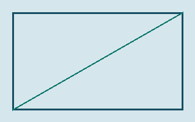
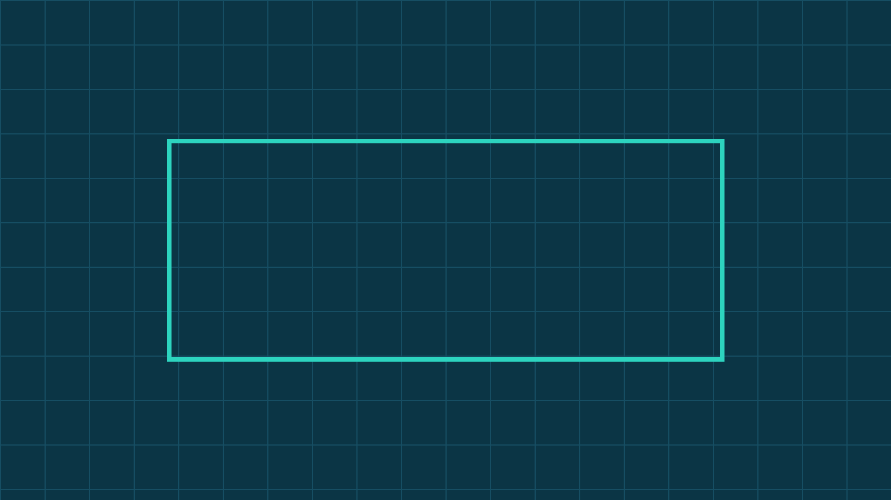

# Muestrario

Todos los elementos de contenido con el tema aplicado: títulos, texto, notas,
código, tablas, figuras y caracteres técnicos. Sirve para revisar el tema en
claro y en oscuro.
{ .lead }

## Texto

La documentación técnica se lee despacio y a menudo se vuelve a ella. Por eso el
texto va en una serif de lectura, con interlineado amplio y líneas que no pasan
de unos setenta y cinco caracteres. Los enlaces, como [esta guía](guia/index.md),
se distinguen por color y subrayado, no solo por color. El *énfasis* y la
**negrita** se usan con moderación; ==el resaltado== también existe, igual que
el ^^insertado^^ y el ~~tachado~~.

Un segundo párrafo para ver el espaciado entre bloques. Las pulsaciones se
escriben así: ++ctrl+shift+p++. Las abreviaturas como HTML muestran su
significado al pasar el cursor.

*[HTML]: HyperText Markup Language

### Listas

- Elemento de una lista sin orden.
- Otro elemento, más largo, que ocupa más de una línea para comprobar que el
  sangrado de la segunda línea queda alineado con el texto y no con la viñeta.
    - Elemento anidado.

1. Primer paso.
2. Segundo paso.
3. Tercer paso.

- [x] Tarea hecha
- [ ] Tarea pendiente

Término
:   Definición del término, en una lista de definiciones.

### Cita

> La claridad es la cortesía del filósofo.

#### Título de cuarto nivel

##### Título de quinto nivel

## Notas

!!! note "Nota"
    Información complementaria. Color de información e icono propio.

!!! tip "Consejo"
    Una forma mejor de hacerlo. Color de éxito.

!!! warning "Atención"
    Algo que puede salir mal si no se tiene en cuenta.

!!! danger "Peligro"
    Una acción que no se puede deshacer.

!!! abstract "Resumen"
    - Lorem ipsum: 8,6 %
    - Dolor sit amet: 2,4 %
    - Consectetur: 8,6 %

??? question "Nota plegable"
    El contenido aparece al desplegarla.

## Código

Código en línea: `uv run zensical build`.

```python title="ejemplo.py" linenums="1"
from pathlib import Path


def leer(ruta: Path) -> str:
    """Devuelve el texto del archivo."""
    return ruta.read_text(encoding="utf-8")  # (1)!
```

1.  Siempre con codificación explícita.

=== "uv"

    ```bash
    uv add --dev techsical
    ```

=== "pip"

    ```bash
    pip install techsical
    ```

## Tablas

| Lorem | Ipsum | Dolor (kN) | Sit (MPa) | Amet |
|---|---|--:|--:|---|
| Consectetur | A-01 | 412,5 | 23,34 | Adipiscing |
| Consectetur | A-02 | 398,1 | 22,53 | Adipiscing |
| Elit | B-07 | 36,0 | 4,61 | Adipiscing |
| Sed do eiusmod | C-03 | 151,2 | 2,14 | Tempor |

Tabla ancha, que en pantallas estrechas se desplaza en horizontal:

| Lorem | Ipsum | Dolor | Sit | Amet | Consectetur | Adipiscing | Elit | Sed do eiusmod |
|---|---|---|--:|--:|--:|--:|---|---|
| Lorem ipsum dolor | f<sub>ck</sub> | MPa | 25 | 30 | 35 | ±5 % | Lorem 206 | Tempor incididunt |
| Sit amet consectetur | E<sub>cm</sub> | GPa | 30 | 33 | 36 | ±3 % | Ipsum 1992 | Ut labore |
| Adipiscing elit | α | 10<sup>−6</sup>/K | 9 | 10 | 12 | — | Ipsum 1992 | Dolore magna |

## Figuras

Imagen pequeña: se centra y no se amplía.



Imagen grande: se reduce al ancho máximo de las figuras.



/// caption
Figura con pie: el pie va en sans, más pequeño.
///

Fórmulas y diagramas: en su [propia página](formulas.md).

## Caracteres técnicos

| Tipo | Ejemplos |
|---|---|
| Griego | α β γ δ ε λ μ π σ τ φ ω Δ Σ Ω |
| Unidades | 25 °C · 3,5 m² · 12 m³ · 50 µm · 9,81 m/s² · 400 kN·m |
| Operadores | ± × ÷ ≤ ≥ ≠ ≈ ∞ √ ∑ ∫ ∂ |
| Subíndices y superíndices | H<sub>2</sub>O · x<sup>2</sup> · f<sub>ck</sub> · 10<sup>−3</sup> |
| Cifras tabulares | 1.111,11 · 8.888,88 · 0,05 |

## Notas al pie

Una afirmación con su nota[^1].

[^1]: La nota al pie aparece al final de la página.
